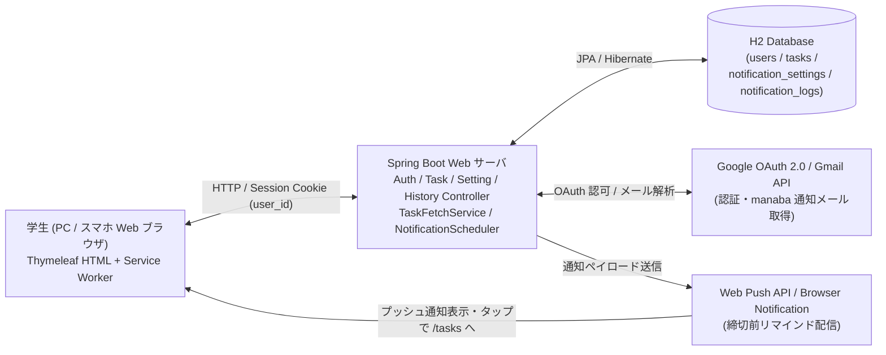
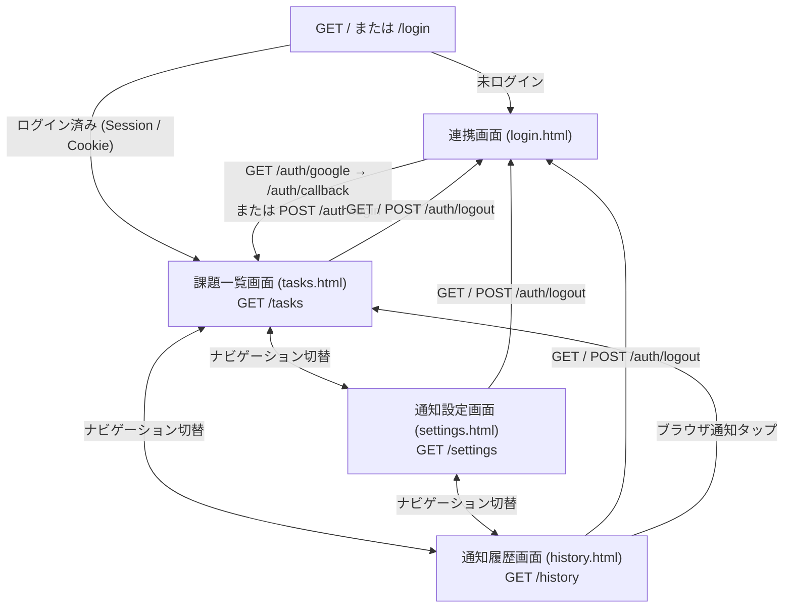
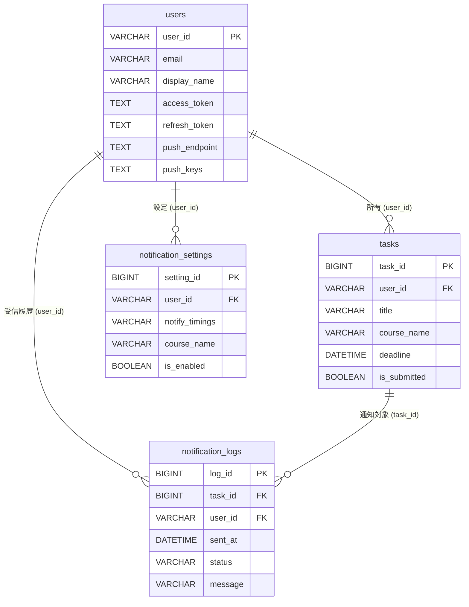

# manaba 課題通知システム (`manaba-notifier`)

チーム12（大友・蘆川・宮川・川邉）による、大学生向け課題リマインド Web アプリケーションです。  
manaba 本体へ直接干渉（スクレイピングやパスワード保存）することなく、**Google OAuth 2.0 / Gmail API による課題メール自動取得**と **Web Push API による締切前通知**を組み合わせて、課題の出し忘れを防ぎます。

---

## 1. システム概要

- **利用者**: manaba を利用する学生（PC・スマートフォン Web ブラウザ対応）
- **主な機能**:
  1. **Google ログイン & Gmail 連携（機能A）**: OAuth 2.0 で安全に認証し、Gmail に届く manaba 課題通知メールから科目名・課題名・締切日時を自動抽出・登録。
  2. **課題一覧・提出済み管理（機能B）**: 課題を締切が近い順に表示し、残り時間・緊急度バッジを可視化。「提出済み」ボタンで以後のリマインド通知を自動停止。
  3. **通知設定（機能C）**: 締切前の複数通知タイミング（例：`24時間前・5時間前・1時間前`）および科目ごとの通知 ON / OFF を設定。
  4. **自動通知送信・通知履歴／再試行（機能D）**: 定期スケジューラ（`@Scheduled`）が未提出課題を判定して Web Push 通知を送信。送信結果（`SUCCESS` / `FAILED`）を履歴表示し、失敗分の再試行にも対応。

---

## 2. チーム12 役割分担表

| グループ | 担当 | 担当機能 | 主な実装ファイル | 解説ドキュメント |
| :--- | :--- | :--- | :--- | :--- |
| **A** | **大友** | 連携・ログイン・課題取得・共通基盤 | `pom.xml`, `application.properties`, `ManabaNotifierApplication.java`, `entity/*`, `repository/*`, `AuthController.java`, `TaskFetchService.java`, `login.html`, `style.css`, `push-client.js`, `sw.js` | [docs/A_otomo_auth_fetch.md](docs/A_otomo_auth_fetch.md) |
| **B** | **蘆川** | 課題一覧・提出済み管理 | `TaskController.java`, `tasks.html` | [docs/B_ashikawa_tasks.md](docs/B_ashikawa_tasks.md) |
| **C** | **宮川** | 通知設定 | `SettingController.java`, `settings.html` | [docs/C_miyakawa_settings.md](docs/C_miyakawa_settings.md) |
| **D** | **川邉** | 通知送信・通知履歴／再試行 | `NotificationScheduler.java`, `HistoryController.java`, `history.html` | [docs/D_kawabe_notification_history.md](docs/D_kawabe_notification_history.md) |

---

## 3. システム構成・画面遷移・データモデル

### 3.1 システム構成図



### 3.2 画面遷移図



### 3.3 ER 図（共通データベース構造）



---

## 4. 起動手順

### 前提環境
- Java 21 以上（Maven は同梱の Maven Wrapper `./mvnw` を利用するため事前インストール不要です）

### 起動コマンド

```bash
cd manaba-notifier
./mvnw spring-boot:run
```

> Windows の場合は `mvnw.cmd spring-boot:run`、環境に Maven が導入済みの場合は `mvn spring-boot:run` でも起動できます。

起動後、ブラウザで以下にアクセスしてください：
- **アプリ URL**: `http://localhost:8080`
- **H2 コンソール（開発・DB確認用）**: `http://localhost:8080/h2-console`
  - JDBC URL: `jdbc:h2:file:./data/manabadb`
  - User Name: `sa` / Password: （空欄）

---

## 5. デモ操作手順（基本利用シナリオ）

詳細設計書の利用シーン（1〜6）に沿って、以下の順で一通りの機能を実演できます。

1. **ログイン・Gmail 課題取得（`/login`）**
   - 「Google アカウントでログイン & Gmail 連携」ボタン（またはメールアドレスフォーム）でログイン。
   - 自動的に manaba 課題サンプル（「ソフトウェア工学」「データベースシステム」「コンピュータネットワーク」「人工知能基礎」）と初期通知設定（`24,5,1`）、初期履歴（`SUCCESS` 1件・`FAILED` 1件）が投入され、`/tasks` へ遷移します。
   - 画面上部の「通知を許可する」ボタンでブラウザの通知許可と `/auth/push-subscribe` 登録を有効化できます。
2. **課題一覧の確認（`/tasks`）**
   - 締切が近い順に並んだ課題と残り時間・緊急度バッジ（`締切間近` 等）を確認します。
   - 必要に応じて「＋ 課題を手動追加」や「Gmail同期」ボタンも試せます。
3. **通知時刻・科目別 ON/OFF の設定（`/settings`）**
   - 通知タイミング（例：`24時間前`, `5時間前`, `1時間前` ＋ カスタム時間）と科目別 ON/OFF を変更して保存します。
   - 「すべて解除」して保存するとバリデーションエラー「通知時刻を正しく設定してください」が表示されることも確認できます。
4. **自動通知チェック & 通知履歴／再試行（`/history`）**
   - 「今すぐ通知チェック実行」を押すと、`NotificationScheduler` が未提出課題と設定を突き合わせて Web Push 通知を発火し、`SUCCESS` 履歴とブラウザ通知ポップアップが表示されます。
   - 「失敗ケースをシミュレート」または初期 `FAILED` ログの「再試行」ボタンを押すと、再送信が実行されて `SUCCESS` へ更新されます。
5. **提出済み切替による通知停止（`/tasks`）**
   - 課題一覧に戻り、対象課題の「提出済みにする」を押すと `is_submitted = true` となり、以降の通知チェック対象から除外されます。

---

## 6. 各担当ドキュメント一覧

- [A: 連携・ログイン・共通基盤（大友）](docs/A_otomo_auth_fetch.md)
- [B: 課題一覧・提出済み管理（蘆川）](docs/B_ashikawa_tasks.md)
- [C: 通知設定（宮川）](docs/C_miyakawa_settings.md)
- [D: 通知送信・通知履歴／再試行（川邉）](docs/D_kawabe_notification_history.md)
- [発表・質疑応答ガイド（4人分まとめ）](docs/PRESENTATION_GUIDE.md)
